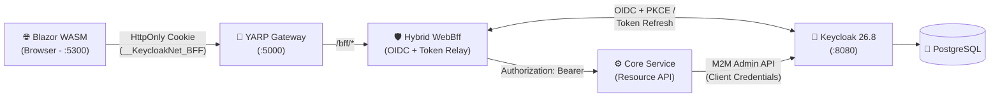

# 🔐 KeycloakNet — .NET 10 & Keycloak (IdP) Integration Architecture

**KeycloakNet** is an end-to-end reference architecture demonstrating modern, secure authentication and authorization in **.NET 10** using **Keycloak** as the centralized Identity Provider (IdP).

It combines the **Hybrid BFF (Backend-for-Frontend)** pattern to eliminate browser token exposure, **YARP API Gateway** routing, and programmatic user management via the **Keycloak Admin REST API**, all orchestrated with **.NET Aspire**.

---

## 🎯 Purpose of the Project

The primary goal of this project is to demonstrate how to integrate **Keycloak** as a centralized Identity Provider (IdP) with **.NET 10** across real-world identity and access management scenarios:

1. **End-to-End Keycloak & .NET 10 Integration:** Configure and orchestrate Keycloak alongside .NET 10 services using **.NET Aspire**, covering OpenID Connect (OIDC), JWT validation, and Role-Based Access Control (RBAC).
2. **Dual User Registration Flows:** Demonstrate two ways of onboarding users into Keycloak—both **User Self-Registration** via Keycloak's login/registration flow and **Programmatic Admin Provisioning** from within the application via the Keycloak Admin REST API (M2M Client Credentials).
3. **Secure Session & Token Management (Hybrid BFF):** Use **Authorization Code Flow + PKCE** and encrypted `HttpOnly` cookies so the browser never handles raw tokens directly, while automatically refreshing and relaying JWTs to backend APIs.

---

## 🏗️ Architecture Overview



### Solution Structure

| Project | Role & Responsibility |
| :--- | :--- |
| **`KeycloakNet.AppHost`** | **.NET Aspire** orchestrator. Launches PostgreSQL, Keycloak (with automatic realm import), and all .NET services with a single command while wiring dynamic service endpoints. |
| **`KeycloakNet.Client`** | **Blazor WebAssembly** frontend. Provides the Dashboard, BFF Test Console, and Admin User Management UI. |
| **`KeycloakNet.Gateway`** | **YARP Reverse Proxy**. Acts as the single external API entry point (`:5000`), routing `/bff/*` traffic and enforcing CORS policies. |
| **`KeycloakNet.WebBff`** | **Hybrid BFF** service. Handles the OIDC flow, stores tokens inside an encrypted cookie, refreshes expiring tokens, validates requests with **FluentValidation**, and relays Bearer tokens to the Core Service. |
| **`KeycloakNet.Service`** | **Core Resource API**. Validates JWT tokens (Audience and Role policies), executes business endpoints, and communicates with the Keycloak Admin API. |
| **`KeycloakNet.KeycloakClient`** | Shared library that interacts with the Keycloak Admin REST API using the **Client Credentials Flow (M2M)**. |

---

## 🔑 Key Features & Authentication Flows

### 1. Two User Registration Approaches
The project implements two distinct ways to register users in Keycloak:

- **A) Self-Registration (User-Initiated):**
  When a user clicks **Register** in the UI, the BFF redirects them directly to Keycloak's registration form (`prompt=create`). Once registered, the user is automatically signed in and redirected back to the application.
- **B) Headless / Admin Provisioning (Programmatic Registration):**
  An administrator (`admin` role) can create new users, set passwords, and assign multiple realm roles (`admin`, `articles:create`, `articles:delete`, etc.) directly from the **User Management** page without ever opening the Keycloak Admin Console. Behind the scenes, the Core Service authenticates against Keycloak using the `keycloaknet-admin-client` service account (**Client Credentials Flow / M2M**).

### 2. Authorization Code Flow + PKCE
User sign-in and self-registration use **OpenID Connect Authorization Code Flow with PKCE (Proof Key for Code Exchange)**. Even if an authorization code is intercepted, it cannot be exchanged for tokens without the corresponding PKCE code verifier.

### 3. BFF Security Bridge, Cookie Management & Boundary Validation
- **Security Bridge (No Tokens in the Browser):** Upon successful login, the `access_token`, `refresh_token`, and `id_token` issued by Keycloak are encrypted and stored inside an `HttpOnly` cookie named `__KeycloakNet_BFF`. Client-side JavaScript cannot access or read these tokens, and the BFF relays them as `Authorization: Bearer <token>` headers to downstream services.
- **Silent Token Refresh:** On every outgoing API call, `TokenRelayHandler` inspects the `expires_at` timestamp stored in the cookie. If the access token is expired—or will expire within **60 seconds**—the BFF automatically exchanges the refresh token with Keycloak, updates the encrypted cookie, and forwards the request with the new token.
- **Application Boundary Validation:** Incoming requests are validated at the BFF edge using **FluentValidation** before reaching the Core Service, and downstream HTTP status codes (`401 Unauthorized`, `403 Forbidden`, `404 Not Found`, etc.) are preserved and returned accurately to the client.
- **Full SSO Logout (RP-Initiated Logout):** Clicking **Log Out** clears the local BFF cookie and redirects to Keycloak's end-session endpoint with `id_token_hint` to terminate the central SSO session.

---

## 📦 Pre-Configured Keycloak Realm (`keycloaknet-realm-export.json`)

When the application starts, .NET Aspire automatically imports `keycloaknet-realm-export.json` into the Keycloak container (`--import-realm`), provisioning the **`keycloaknet-realm`** with self-registration enabled (`registrationAllowed: true`), custom roles, and three purpose-built OIDC clients:

### Custom Clients
| Client ID | Type | Why It Exists |
| :--- | :--- | :--- |
| **`keycloaknet-web-bff`** | Confidential (`Authorization Code + PKCE`) | Used by `KeycloakNet.WebBff` to handle interactive user login, self-registration, logout, and token refresh. Includes an `oidc-audience-mapper` so issued access tokens automatically contain `keycloaknet-service-client` in their `aud` claim. |
| **`keycloaknet-service-client`** | Resource / Audience Target | Represents `KeycloakNet.Service`. The Core Service validates that incoming Bearer tokens explicitly carry `aud: "keycloaknet-service-client"`. |
| **`keycloaknet-admin-client`** | Confidential (`Service Account / M2M`) | Dedicated Machine-to-Machine client with `realm-management` permissions (`manage-users`, `view-users`, `view-realm`). Used by `KeycloakNet.KeycloakClient` via the **Client Credentials Flow** to create/delete users and assign roles programmatically. |

### Custom Realm Roles
- **`admin`**: Grants access to `/api/admin/*` endpoints for user and role management.
- **`articles:read`**, **`articles:create`**, **`articles:delete`**: Fine-grained permission roles enforced on article endpoints in `KeycloakNet.Service`.

---

## 🚀 Getting Started & Default Endpoints

Ensure you have the **.NET 10 SDK** and **Docker** installed. PostgreSQL and Keycloak (pre-configured via `keycloaknet-realm-export.json`) are started automatically by .NET Aspire:

```bash
dotnet run --project src/KeycloakNet.AppHost
```

| Service | Default URL | Details |
| :--- | :--- | :--- |
| **Blazor Web UI (`Client`)** | `http://localhost:5300` | Web UI, BFF Test Console, and User Management |
| **YARP API Gateway (`Gateway`)** | `http://localhost:5000` | External API Gateway (`/bff/*`) |
| **Keycloak Admin Console** | `http://localhost:8080` | Username: `admin` / Password: `adminpassword` |

---

## 🔒 HTTP Mode & How to Switch to HTTPS

To keep local development friction-free without certificate trust issues, the project runs over **HTTP** by default.

When moving to Production or enabling **HTTPS**, update the following 5 areas:

### 1. AppHost (`src/KeycloakNet.AppHost/AppHost.cs`)
- **Enforce HTTPS Metadata:**
  Set `Authentication__Keycloak__RequireHttpsMetadata` to `"true"` for both `core-service` and `web-bff`:
  ```csharp
  .WithEnvironment("Authentication__Keycloak__RequireHttpsMetadata", "true")
  ```
- **Switch Endpoints to HTTPS:**
  Replace `.WithHttpEndpoint(...)` with `.WithHttpsEndpoint(...)` on `client` and `gateway`, and reference `GetEndpoint("https")`.
- **Keycloak Container TLS:**
  Run Keycloak in production mode (`start` instead of `start-dev`) with TLS certificates (`KC_HTTPS_CERTIFICATE_FILE`, `KC_HTTPS_CERTIFICATE_KEY_FILE`) or behind an HTTPS-terminating reverse proxy (`KC_PROXY_HEADERS=xforwarded`).

### 2. WebBff Cookie Security (`src/KeycloakNet.WebBff/Program.cs`)
- Enforce HTTPS-only transmission for the BFF session cookie:
  ```csharp
  options.Cookie.SecurePolicy = CookieSecurePolicy.Always;
  // If running across different domains over HTTPS:
  // options.Cookie.SameSite = SameSiteMode.None;
  ```

### 3. Blazor WASM Gateway URL (`src/KeycloakNet.Client/KeycloakNet.Client.Client/wwwroot/appsettings.json`)
- Update the Gateway base address to `https://`:
  ```json
  {
    "Gateway": {
      "BaseUrl": "https://localhost:5000"
    }
  }
  ```

### 4. Keycloak Realm Client Settings (`keycloaknet-realm-export.json` / Admin Console)
- Update **Valid Redirect URIs**, **Valid Post Logout Redirect URIs**, and **Web Origins** for the `keycloaknet-web-bff` client in Keycloak to use `https://...`.

### 5. Local Development Certificate (For Local HTTPS Testing)
- Ensure the local .NET development certificate is trusted:
  ```bash
  dotnet dev-certs https --trust
  ```

---

## ⚠️ Security Note on Secrets & Configuration

Because this repository is an educational reference project designed to run out-of-the-box with a single `dotnet run` command, development credentials (such as PostgreSQL passwords, Keycloak admin credentials, and OIDC `ClientSecret` values matching `keycloaknet-realm-export.json`) are included directly in `src/KeycloakNet.AppHost/appsettings.json`.

**In a real-world or production environment, never store sensitive secrets in `appsettings.json` or commit them to source control:**
- **Local Development:** Use **.NET Secret Manager (`dotnet user-secrets`)** or local `.env` files excluded via `.gitignore`.
- **Production / CI-CD:** Inject secrets at runtime via **Environment Variables**, **Kubernetes Secrets**, or a dedicated secret store such as **Azure Key Vault**, **AWS Secrets Manager**, or **HashiCorp Vault**.

